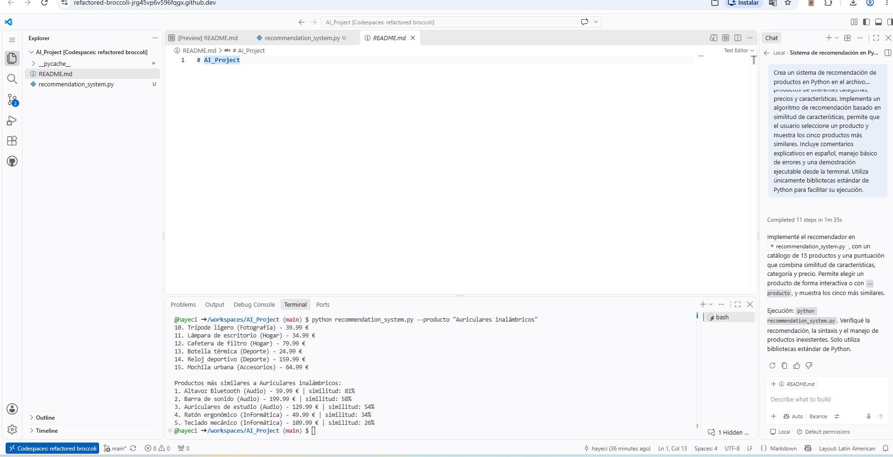

# AI_Project – Sistema de recomendación de productos

## 1. Descripción
Proyecto desarrollado para la actividad formativa de la Unidad 3 de Inteligencia Artificial (ETDI02), INACAP.

Se implementó un sistema de recomendación de productos en Python con asistencia de GitHub Copilot.

## 2. Objetivo
Desarrollar y ejecutar un programa capaz de recomendar cinco productos similares a uno seleccionado, considerando sus características, categoría y precio.

## 3. Herramientas utilizadas
- GitHub: repositorio y control de versiones.
- GitHub Codespaces: entorno de desarrollo en línea.
- GitHub Copilot: asistencia para generar código.
- Python: lenguaje de programación.

## 4. Procedimiento
1. Se creó el repositorio AI_Project.
2. Se añadió el archivo README.md.
3. Se abrió GitHub Codespaces.
4. Se creó recommendation_system.py.
5. Se utilizó GitHub Copilot para generar el código.
6. Se revisó y aceptó el código.
7. Se ejecutó el programa y se verificaron sus resultados.
8. Se documentó el proyecto.

## 5. Funcionamiento
El programa utiliza un catálogo de 15 productos y calcula similitudes según características, categoría y precio.

## 6. Ejecución
```bash
python recommendation_system.py --producto "Auriculares inalámbricos"
```

## 7. Resultados

| Producto recomendado | Similitud |
|---|---:|
| Altavoz Bluetooth | 81 % |
| Barra de sonido | 58 % |
| Auriculares de estudio | 54 % |
| Ratón ergonómico | 34 % |
| Teclado mecánico | 26 % |

La ejecución finalizó sin errores.

## 8. Evidencias
Capturas del repositorio, código generado con Copilot y resultados de ejecución. 


## 9. Conclusión
GitHub Copilot permitió asistir el desarrollo de un sistema funcional de recomendaciones en Python, aplicando inteligencia artificial al proceso de programación.

## 10. Repositorio
https://github.com/hayeci/AI_Project